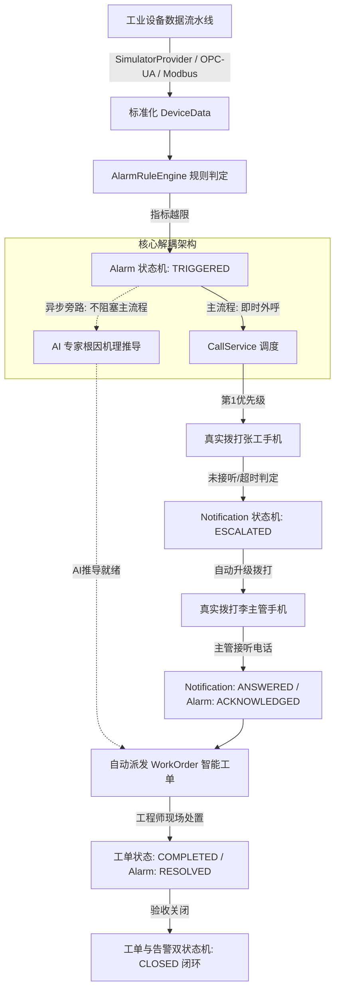

# AI 无人值守工厂智能告警与自动处置平台 V1.0

> 面向工业 4.0 与智慧制造无人值守场景设计的工业设备越限监控、真实电话语音外呼、自动升级与智能工单全流程闭环演示系统。支持现场接入**阿里云语音服务 (Dyvmsapi) 真实拨打客户与值班人员手机**，支持全容器化一键启动。

---

## 🌟 核心业务闭环流程



---

## 🏗️ 架构与技术栈设计原则

1. **持久层规范**：
   - 后端使用 **FastAPI + SQLAlchemy 2.0 (Mapped/mapped_column 语法) + Alembic + SQLite**。
   - 严禁任何原生 `sqlite3/cursor.execute()`，所有数据访问均通过 ORM 领域模型操作，无缝兼容后续平滑切换 PostgreSQL。

2. **独立状态机模块 (`app/state_machine/`)**：
   - **报警状态机 (`alarm.py`)**：`NORMAL ➔ TRIGGERED ➔ ACKNOWLEDGED ➔ PROCESSING ➔ RESOLVED ➔ CLOSED`
   - **呼叫通知状态机 (`notification.py`)**：`IDLE ➔ CALLING ➔ ANSWERED ➔ UNANSWERED / REJECTED ➔ ESCALATED`
   - **智能工单状态机 (`workorder.py`)**：`PENDING ➔ IN_PROGRESS ➔ COMPLETED ➔ CLOSED`
   - **铁律**：业务逻辑中严禁直接对状态字段赋值（如 `alarm.status = "RESOLVED"`），全部统一调用状态机的 `transition(...)` 触发前置校验、持久化审计流水与广播事件钩子。

3. **设备接入层（适配器模式）**：
   - 报警规则引擎仅面向标准化的 `DeviceData` 结构，与底层数据源物理协议完全解耦。
   - 当前内置 `SimulatorProvider`，未来扩展 `OpcUaProvider`、`ModbusProvider`、`MqttProvider` 仅需实现 `BaseDeviceProvider` 接口即可无缝热插拔。

4. **电话呼叫层（阿里云真实外呼 + 模拟降级通道）**：
   - 适配器架构：`BaseCallProvider` 抽象接口，实现 `AliyunCallProvider`（官方 Dyvmsapi 真实手机拨打）与 `MockCallProvider`（离线演练仿真通道）。
   - 提供回执 Webhook 端点 `/api/calls/callback/aliyun`，支持接收运营商接听状态。
   - 演示现场可在右上角抽屉直接修改接收外呼的真实手机号，并能随时热切换线路通道。

5. **主流程与 AI 深度解耦**：
   - AI 分析作为**非阻塞异步旁路**（通过异步协程在后台计算），绝不阻塞毫秒级紧急电话外呼主链路。

6. **极简原则**：
   - 严禁引入 Redis、Celery、Kubernetes 等沉重组件。异步任务统一利用 FastAPI 原生协程处理，秒级启动，极简轻量。

7. **前端大屏技术栈**：
   - React 18 + TypeScript + Ant Design 5 + ECharts + 原生 WebSocket。
   - 顶栏常驻“🎬 演示模式 (Demo Mode)”控制台抽屉，具备高科技呼叫状态动态面板与 3 分钟黄金路径编排。

---

## 🚀 快速启动（Docker 一键运行）

### 1. 准备配置文件
复制并按需编辑环境变量：
```bash
cp .env.example .env
```
如需真实外呼真实手机号，请在 `.env` 中填入阿里云账号信息：
```ini
# 切换为真实外呼模式
CALL_PROVIDER=aliyun

# 阿里云 AccessKey
ALIBABA_CLOUD_ACCESS_KEY_ID=LTAI5txxxxxxxxxx
ALIBABA_CLOUD_ACCESS_KEY_SECRET=xxxxxxxxxxxxxxxxxxxxxxxx

# 阿里云审核通过的语音通知模板 ID (如包含 ${device}、${metric}、${value} 等参数)
TTS_CODE=TTS_2026100301

# 现场测试手机号码
DEMO_PRIMARY_CONTACT_PHONE=13800000001
DEMO_SECONDARY_CONTACT_PHONE=13900000002
```
*注：若未配置阿里云凭证，系统默认使用 `CALL_PROVIDER=mock` 模式，所有功能与大屏联动 100% 正常运行。*

### 2. 一键构建并启动容器
在工程根目录下执行：
```bash
docker compose up --build -d
```

### 3. 访问系统
- **前端工业智能大屏**：[http://localhost:3000](http://localhost:3000)
- **后端 Swagger API 交互文档**：[http://localhost:8000/docs](http://localhost:8000/docs)
- **系统健康检查端点**：[http://localhost:8000/health](http://localhost:8000/health)

---

## 🎬 甲方现场 3 分钟核心场景闭环演示手册

在向客户高管或评审专家演示时，请按照以下“黄金路径”进行节奏把控：

| 步骤 | 演示画面与操作 | 背后运行逻辑与话术重点 |
| :--- | :--- | :--- |
| **Step 0: 背景阐述** | 打开系统大屏，向客户展示深夜 03:28:15 工厂处于**全无人值守状态**，三台核心机组平稳运行，各项物理指标平稳流动。 | “各位领导，目前工厂处于夜间无人值守工况，传统系统往往依赖监控人员肉眼看盘，极易发生重大停机事故。” |
| **Step 1: 故障注入** | 点击右上角 **“🎬 演示模式”** ➔ 点击 **“[故障1] 模拟主泵液压失压泄漏”**（或直接点击 **“一键启动 3 分钟闭环演示”**）。 | 模拟器立即注入主液压回路微小裂纹演变数据，主泵压力由 25.0 MPa 骤降并跌破 18.0 MPa。 |
| **Step 2: P1 致命告警** | 大屏瞬间泛起红光脉冲告警，ECharts 曲线中压力跌穿红色虚线阈值，实时报警列表显示 `[P1] 主泵出口压力异常骤降失压`。 | 规则引擎捕获标准化 `DeviceData` 越限，触发 `AlarmStateMachine` 进入 `TRIGGERED`。 |
| **Step 3: 真实外呼 + AI推导** | 呼叫状态面板亮起，显示**“正在向第一联系人 张工 拨打电话...”**，现场对应手机开始真实震动响铃并播报 TTS 语音！与此同时，右侧 AI 卡片显示正在进行神经网络机理推导。 | **核心亮点**：外呼毫秒级触发，AI 异步旁路并行，主流程绝不受大模型耗时阻塞！ |
| **Step 4: 超时升级演示** | 演示人员故意不接听第一联系人手机（或在面板点击 **“模拟超时未接听”**）。8 秒后系统判定一线人员脱岗，呼叫面板状态流转为 `ESCALATED`，**立即自动升级拨打第二联系人（李主管）真实手机号！** | 呼叫状态机自动执行升级策略，确保险情 100% 触达管理层，拒绝警情沉没。 |
| **Step 5: 接听确认与自动工单** | 第二联系人接听电话并听取 TTS 语音播报（或点击 **“模拟已接听”**）。系统收到回执，报警状态流转为 `ACKNOWLEDGED`，右侧**自动生成带 AI 根因诊断与排查步骤的智能维修工单**！ | 呼叫状态机与工单状态机联动，AI 已精准输出“主泵单向阀疲劳撕裂内泄”机理与安全操作指南。 |
| **Step 6: 闭环归档** | 界面点击工单 **“接单处置”** ➔ 点击 **“排查维修完成”** ➔ 提交排查记录并确认。工单与报警双状态机流转为 `CLOSED`，大屏告警解除，压力恢复正常。 | “从故障发生、电话穿透通知、超时升级、AI 诊断、自动派工到维修验收，全过程用时仅 3 分钟，实现真正无人值守安全闭环！” |

---

## ⚙️ 阿里云语音服务 (Dyvmsapi) 对接指南

如需在正式环境开通真实语音外呼，步骤如下：
1. 登录阿里云控制台，开通 **语音服务 (Dyvmsapi)**。
2. 在 **AccessKey 管理** 中创建具备 `AliyunDyvmsapiFullAccess` 权限的密钥，配置到 `.env` 的 `ALIBABA_CLOUD_ACCESS_KEY_ID` 与 `ALIBABA_CLOUD_ACCESS_KEY_SECRET`。
3. 在语音服务控制台 ➔ **文本转语音 (TTS) 模板** 提交模板审核，示例内容：
   ```text
   紧急告警通知：您的工业机组${device}发生${level}级严重异常，指标${metric}当前值为${value}，已超出安全阈值${threshold}，系统已自动创建应急工单，请立即前往现场或远程平台处置！
   ```
4. 模板审核通过后获得模板代号（如 `TTS_2026100301`），配置到 `.env` 的 `TTS_CODE` 即可生效。

---

## 📁 核心工程目录索引

```text
factory-ai-alarm/
├── docker-compose.yml           # 容器编排入口 (支持 docker compose up --build)
├── .env.example                 # 环境变量配置模板
├── backend/                     # 后端工程 (FastAPI + SQLAlchemy 2.0 ORM + Alembic)
│   ├── app/
│   │   ├── main.py              # 应用入口与生命周期管理
│   │   ├── core/config.py       # Pydantic 集中配置
│   │   ├── database/session.py  # SQLAlchemy 2.0 Engine 与 ORM Base
│   │   ├── models/              # Device, Alarm, AlarmEvent, Call, Contact, AI, WorkOrder
│   │   ├── schemas/             # Pydantic 数据交互契约
│   │   ├── state_machine/       # 核心独立状态机 (alarm.py, notification.py, workorder.py)
│   │   ├── simulator/           # 适配器设备仿真与标准化 DeviceData (scenarios.py, provider.py)
│   │   ├── alarm_engine/        # 工业规则判定引擎 (engine.py)
│   │   ├── services/            # 领域业务服务 (call/, alarm/, ai/, notification/, workorder/)
│   │   └── websocket/           # WebSocket 实时广播总线 (manager.py)
│   ├── Dockerfile
│   └── requirements.txt
└── frontend/                    # 前端工程 (React 18 + TypeScript + Ant Design + ECharts)
    ├── src/
    │   ├── pages/DashboardPage.tsx       # 工业数字化大屏核心主页
    │   ├── components/
    │   │   ├── CallStatusPanel.tsx      # 外呼状态实时监控卡片
    │   │   ├── DemoDrawer.tsx           # 🎬 演示模式控制台抽屉
    │   │   ├── AIAnalysisCard.tsx       # AI 根因推导卡片
    │   │   ├── WorkOrderCard.tsx        # 智能维修工单卡片
    │   │   └── TelemetryChart.tsx       # 工业实时遥测趋势曲线
    │   ├── services/api.ts              # REST API 客户端
    │   └── websocket/useWebSocket.ts    # WebSocket 客户端连接钩子
    ├── Dockerfile
    ├── nginx.conf
    └── package.json
```
